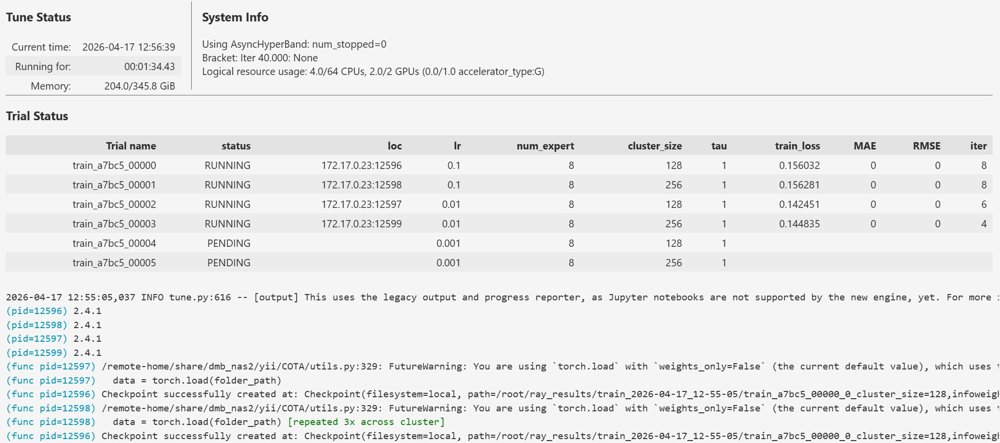

# POTC: Prototype Prompting for Cross-Domain Recommendation

POTC learns correspondence between source and target user prototypes from overlapping user identities and optimal transport, then uses target-domain prototype prompts for cross-domain recommendation.

## Getting started

1. Clone the repository and install the dependencies (Python 3.10 or newer):

   ```bash
   git clone https://github.com/yspohoo/POTC.git
   cd POTC
   python -m pip install -r requirement.txt
   ```

2. Obtain the Amazon review JSON files or Douban movie/music review TSV files. Set their paths in `variable.py`. For Douban, also set `DOUBAN_PROCESSED_ROOT` to a new or empty output directory.

3. Start Jupyter and run `amazon-preprocess.ipynb` or `douban_preprocess.ipynb` to prepare the chosen dataset:

   ```bash
   jupyter notebook
   ```

4. Pretrain the source and target encoders for the chosen direction. For example:

   ```bash
   python pretrain.py --dataset amazon --source movie --target music
   ```

   For Douban, use `--dataset douban`. Select the CUDA device in `pretrain.py` to match your machine. Each task saves its encoders under its own `weights/` directory.

5. Open `main-train-edited.ipynb`, set `dataset`, `source_domain`, `target_domain`, the search ranges and GPU allocation, then run the notebook. Ray Tune selects the checkpoint by validation HR@10 and reports held-out test results. Use the same dataset and direction as in step 4.

## Project structure

```text
POTC/
├── data/
│   ├── readme.txt                 Dataset download links
│   ├── amazon/                    Domain interactions, ID maps, splits and overlap pairs
│   ├── douban/                    Available Douban input files
│   └── weight/lightgcn/           Previously saved domain encoder weights
├── visualize/                     Output directory for embedding plots and analyses
├── amazon-preprocess.ipynb         Amazon preprocessing notebook
├── amazon_preprocess.py            Amazon preprocessing functions
├── douban_preprocess.ipynb          Douban preprocessing notebook
├── douban_preprocess.py             Douban preprocessing functions and CLI
├── pretrain.py                     Task-specific LightGCN pretraining
├── main-train-edited.ipynb          Transfer training and hyperparameter search
├── run_edited.py                   Training and evaluation
├── models.py                       POTC and encoder models
├── utils_edited.py                 Loading, sampling, metrics and transport
├── data_protocol.py                Split and checkpoint validation
├── analysis_visualize.py            Embedding analysis and plotting
├── analysis-visualize.ipynb         Analysis notebook
├── variable.py                     Paths and shared settings
├── requirement.txt                 Python dependencies
└── train-example.jpg               Training example
```

The bundled data include processed Amazon files and partial Douban inputs; download missing raw files using `data/readme.txt`. The current preprocessing workflow creates task-specific `source/` and `target/` training graphs, and pretraining saves matching checkpoints in each task's `weights/` directory. The older files under `data/weight/lightgcn/` do not replace these checkpoints. `visualize/` is initially empty and holds generated analysis outputs.

## Training example


